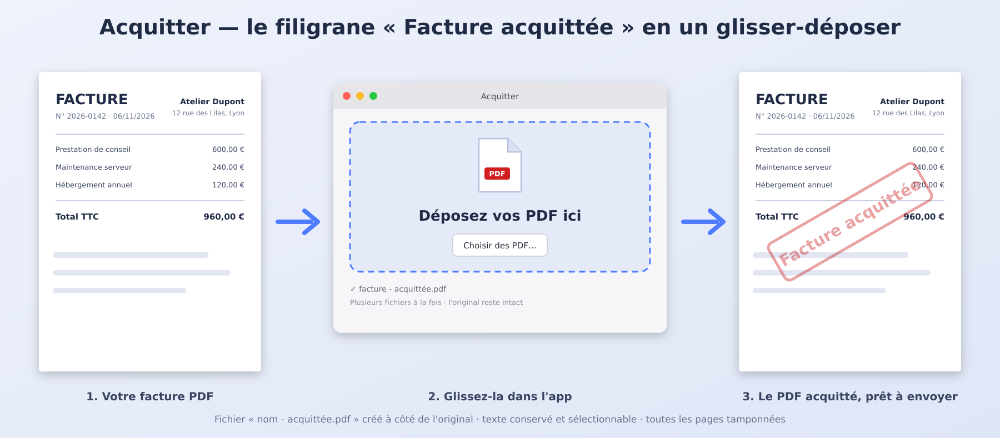

# Acquitter

Petite app macOS (Swift, sans dépendance) qui ajoute un filigrane **« Facture acquittée »** sur des PDF, par simple glisser-déposer.



## Ce qu'elle fait

- Glissez un ou plusieurs PDF dans la fenêtre (ou sur l'icône de l'app, ou via « Choisir des PDF… »).
- Elle crée `nom - acquittée.pdf` à côté de l'original, qui reste intact, puis l'affiche dans le Finder.
- Le tampon rouge semi-transparent, incliné et encadré est centré sur **toutes les pages**.
- Le texte reste vectoriel et sélectionnable.

## Installation

```sh
xcode-select --install   # une seule fois, si besoin
./build.sh
```

Cela crée `Acquitter.app` : glissez-la dans `/Applications`. Au premier lancement, clic droit puis **Ouvrir** (l'app n'est pas signée par un compte développeur).

## Personnaliser

Le texte, l'opacité, l'angle, la taille et la couleur se règlent en haut de `main.swift`, puis relancez `./build.sh`.

## Limites

- Les liens cliquables et annotations du PDF d'origine ne sont pas conservés.
- Les PDF protégés par mot de passe sont refusés.

## Contenu

| Fichier | Rôle |
|---|---|
| `main.swift` | Le code de l'app |
| `Info.plist` | Métadonnées de l'app |
| `AppIcon.icns` | Icône |
| `build.sh` | Compile et assemble `Acquitter.app` |
| `docs/` | Image d'aperçu et sources de l'icône |

---

Réalisé avec [Claude](https://claude.ai) (Anthropic).
